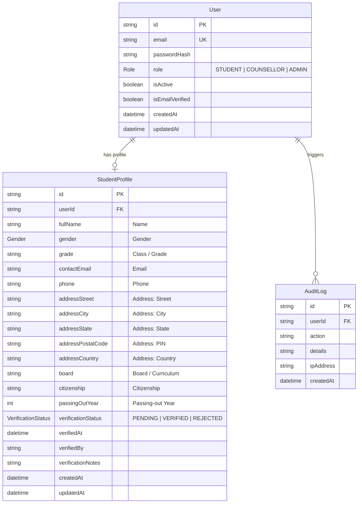

# Database Schema Design & Data Dictionary

The persistence layer is built on PostgreSQL using Prisma ORM. It establishes strong relational constraints, index optimization, and data validation.

---

## 1. Entity Relationship Overview

---

## 2. Module 1 Field Specification

| Intake Field | Prisma Column | Data Type | Validation Rules | Description |
| :--- | :--- | :--- | :--- | :--- |
| **Name** | `fullName` | `String` | Length: 2–100 chars | Full legal student name |
| **Gender** | `gender` | `Enum (Gender)` | `MALE, FEMALE, NON_BINARY, OTHER, PREFER_NOT_TO_SAY` | Self-identified gender |
| **Class / Grade** | `grade` | `String` | Length: 1–50 chars | Current academic level (e.g. "Grade 12", "Undergraduate") |
| **Email** | `contactEmail` | `String` | Valid RFC 5322 email | Official contact email for consultancy notifications |
| **Phone** | `phone` | `String` | Length: 5–20 digits | Contact phone number with country code |
| **Address** | Composite | 5 Strings | `addressStreet`, `addressCity`, `addressState`, `addressPostalCode`, `addressCountry` | Physical residential address for verification |
| **Board / Curriculum** | `board` | `String` | Length: 2–100 chars | Curriculum standard (e.g. CBSE, ICSE, IB, State Board) |
| **Citizenship** | `citizenship` | `String` | Length: 2–100 chars | Country of citizenship (critical for visa & college eligibility) |
| **Passing-out year** | `passingOutYear` | `Int` | Integer: 1990–2040 | Year of secondary / higher-secondary completion |

---

## 3. Indexes & Performance Optimization

- `User(email)`: Unique B-tree index for O(1) login lookup.
- `StudentProfile(userId)`: Unique index ensuring 1:1 relationship between account and profile.
- `StudentProfile(verificationStatus)`: Index to support instant querying of the Counsellor verification queue.
- `StudentProfile(grade, board, passingOutYear)`: Composite lookup indexes ready for future module integrations.
