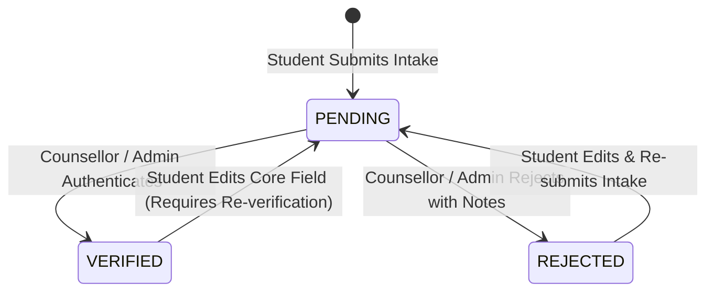

# Module 1 — Account & Profile Intake Specification

## 1. Module Objective

Module 1 is the foundational intake gate of the **Superconsciousness** platform. Its mission is to capture, validate, and persist an authoritative, verified student record. This verified record serves as the essential baseline upon which later guidance, counselling, and recommendations are conducted.

---

## 2. Profile Intake Fields Specification

The following 9 fields are mandatory for every student record:

1. **Name (`fullName`)**:
   - Legal full name of the student.
   - Validation: Min 2, Max 100 characters, trimmed.
2. **Gender (`gender`)**:
   - Enumerated value: `MALE`, `FEMALE`, `NON_BINARY`, `OTHER`, `PREFER_NOT_TO_SAY`.
3. **Class / Grade (`grade`)**:
   - Current academic stage (e.g. `Grade 9`, `Grade 10`, `Grade 11`, `Grade 12`, `Undergraduate Year 1`, `Undergraduate Year 2`, etc.).
4. **Email (`contactEmail`)**:
   - Verified student communication address (validated via RFC 5322 regex).
5. **Phone (`phone`)**:
   - Student contact telephone number with country dialing code.
6. **Address (`address`)**:
   - Structured composite object:
     - `street`: Street address, house/flat number.
     - `city`: Municipality or city.
     - `state`: State or Province.
     - `postalCode`: PIN code or Postal Code.
     - `country`: Country of residence.
7. **Board / Curriculum (`board`)**:
   - Academic syllabus standard (e.g. `CBSE`, `ICSE / ISC`, `State Board`, `IB`, `Cambridge`, `Other / Equivalent`).
8. **Citizenship (`citizenship`)**:
   - Country of citizenship (vital for international admissions, visas, and domicile eligibility).
9. **Passing-Out Year (`passingOutYear`)**:
   - Expected or completed year of graduation (e.g. `2025`, `2026`).
   - Range validation: 1990–2040.

---

## 3. Verification State Machine

- **`PENDING`**: Initial state upon student intake submission. Readily queryable in the Counsellor verification queue.
- **`VERIFIED`**: Counsellor confirms data authenticity. Sets `verifiedAt` timestamp and records `verifiedBy` counsellor ID.
- **`REJECTED`**: Counsellor flags incorrect or unverified documents with explanatory notes in `verificationNotes`.

---

## 4. API Endpoints for Module 1

- `POST /api/v1/profile/intake`: Student submits or updates their intake record (open while PENDING or REJECTED).
- `GET /api/v1/profile/me`: Student views their own record and verification badge (open while PENDING or REJECTED).
- `GET /api/v1/profile/me/verified`: Strictly gated to VERIFIED students; returns official verified record & guidance clearance (blocked with 403 if PENDING or REJECTED).
- `GET /api/v1/profile/review`: Counsellor/Admin retrieves paginated pending profiles.
- `GET /api/v1/profile/:id`: Counsellor/Admin inspects a specific student record.
- `PATCH /api/v1/profile/:id/verify`: Counsellor/Admin sets status to `VERIFIED` or `REJECTED` with notes.
